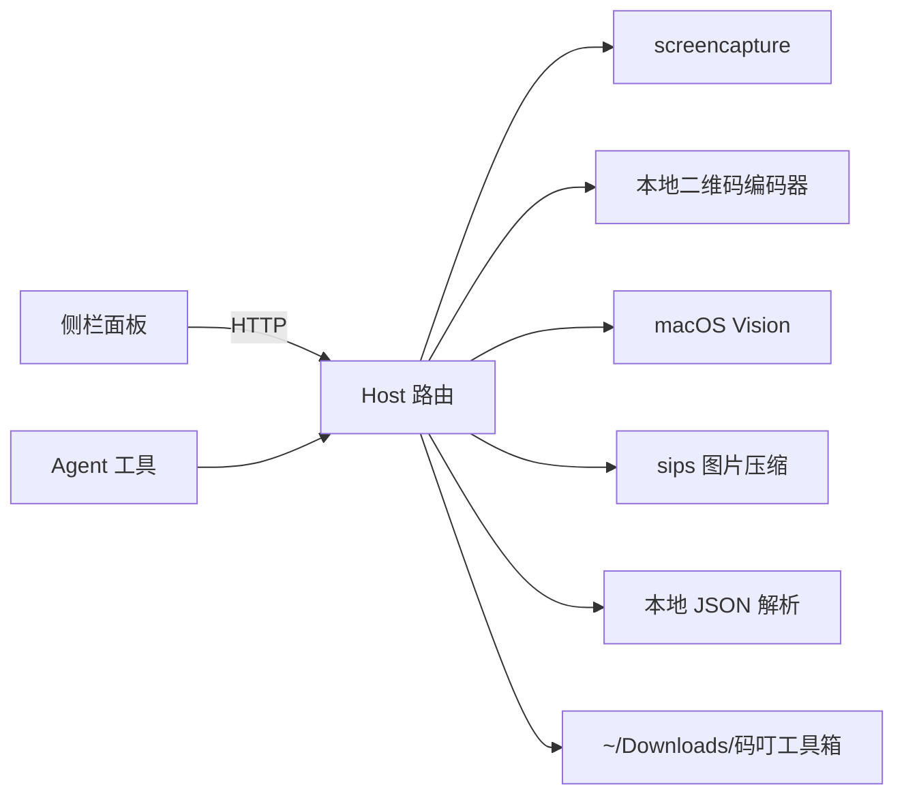

<div align="center">
  
  <h1>码叮工具箱</h1>
  <p><strong>DeepSeek Harness 的本地小工具箱</strong></p>
  <p>截屏、出码、识码、压图、理 JSON —— 都不离开本机。</p>
  <p>
    
    
    
    
    <a href="https://github.com/liulxiang/madingbox"></a>
  </p>
</div>

> 第二期把五件高频小事收进同一个侧栏：留下屏幕、生成/识别二维码、把图片压小、把 JSON 理顺。
>
> 没有云上传，没有账号，没有隐藏的网络请求。所有内容只经过本机内存与你的下载目录。

---

## 为什么是它

在 DSH 里干活时，截图和二维码往往要离开当前窗口：打开系统截图、再打开某个网页工具、上传图片、等广告、担心内容被传到别人服务器。

码叮工具箱把这些步骤收进 DSH 侧栏，同时暴露成 Agent 工具。你可以自己点，也可以直接对 Agent 说「帮我截个全屏」「把这段网址做成二维码」「把这张图压到 200KB 以内」「把这段 JSON 格式化」。

## 能做什么

| 能力 | 你会得到 | 细节 |
| --- | --- | --- |
| **全屏截图** | 主显示器 PNG | 支持延迟、鼠标指针开关 |
| **区域截图** | 框选区域 PNG | 调起系统取景器，Esc 随时取消 |
| **窗口截图** | 单个窗口 PNG | 自动去掉窗口阴影 |
| **二维码生成** | PNG + SVG 各一份 | 文字 / 网址 / Wi-Fi / 邮箱；L/M/Q/H 纠错 |
| **二维码样式** | 可扫的自定义码 | 码点：方块 / 圆角 / 圆点 / 菱形；码眼：方块 / 圆角 / 圆形；128–2048px、静区 0–8、前景/背景色 |
| **二维码识别** | 图片里的全部文本 | macOS Vision 本地识别，不联网 |
| **图片压缩** | 更小的 PNG / JPEG | 系统 `sips`；质量 1–100、最长边可缩放；GIF 会丢动画故拒绝 |
| **JSON 格式化** | 格式化 / 最小化 / 校验结果 | 2/4 空格或 Tab 缩进；语法错误给出行列位置 |
| **历史与预览** | 输出目录里的截图 / 二维码 / 压缩图 | 缩略图、大图、复制图片、在访达中显示 |

### 实际输出

生成：

```text
二维码已生成：~/Downloads/码叮工具箱/二维码/真机验证.png
SVG：~/Downloads/码叮工具箱/二维码/真机验证.svg
版本：5（37 × 37 模块，320px）
样式：码点 圆点 · 码眼 圆形
```

识别：

```text
在 真机验证.png 里识别到 1 个二维码：

#1
码叮工具箱 · 真机验证 https://example.com/mading
```

压缩：

```text
压缩完成：~/Downloads/码叮工具箱/压缩/产品图-压缩.jpg
尺寸：1600 × 1200
大小：4.2 MB → 486 KB（节省 88%）
格式：jpeg
```

## 安装

### 通过 DSH 插件管理（推荐）

1. 克隆或下载本仓库到本地：

   ```bash
   git clone https://github.com/liulxiang/madingbox.git
   ```

2. 在 DSH 中安装这个本地 bundle：调用 `plugin_manager.install_bundle`，`target` 指向仓库根目录。
3. **完全退出并重启 DSH**，Host 与 Web 两端才会加载新插件。

本包是本地 bundle，不发布到 npm。

### 手工安装（开发调试）

如果插件管理不可用，可以把仓库链接进当前 profile：

```bash
PROFILE=~/.dsh/profiles/desktop
REPO=/absolute/path/to/mading-toolbox

ln -s "$REPO" "$PROFILE/node_modules/dsh-mading-toolbox"
```

然后在 `$PROFILE/package.json` 中：

```jsonc
{
  "dependencies": {
    "dsh-mading-toolbox": "link:/absolute/path/to/mading-toolbox"
  },
  "dsh": {
    "profile": {
      "bundles": [
        // …原有 bundle…
        "dsh-mading-toolbox"
      ]
    }
  }
}
```

重启 DSH 生效。包名必须是 `dsh-mading-toolbox`，改名后需要重新安装。

## 使用

### 在侧栏里用

重启后，左侧栏出现「码叮工具箱」图标，点开是四个标签页。

**截图**

选全屏 / 区域 / 窗口 → 点「开始截图」。区域和窗口会交给系统取景器；按 Esc 取消不会留下空文件。右侧是输出目录里的历史，点缩略图看大图，也可以复制到剪贴板或直接在访达中定位。

**二维码**

左边填内容，右边实时预览。调尺寸、纠错、静区、码点样式、码眼样式和颜色时预览会跟着变；码点可选方块 / 圆角 / 圆点 / 菱形，码眼可选方块 / 圆角 / 圆形，保存前就能看到实际效果。「保存 PNG + SVG」写入输出目录。「识别图片」可以选任意本地图片，识别结果支持复制，或一键填回输入框继续改样式。

**图片压缩**

点「选择图片」或粘贴绝对路径，先是原图信息；选输出格式、JPEG 质量和最长边，点「开始压缩」。结果卡会显示压缩后的图、尺寸和体积变化，右侧历史里能回看每一张。

**JSON**

粘贴 JSON，点「格式化」「最小化」或「校验」。合法时给出输出与行数/字节数/键数，不合法时直接标出行列位置；结果可以一键复制。

### 让 Agent 来用

插件注册了五个 Host 工具：

| 工具 | 作用 | 可以这样说 |
| --- | --- | --- |
| `mading_screenshot` | 抓全屏 / 区域 / 窗口 | 「帮我截个全屏」「截个窗口，延迟 3 秒」 |
| `mading_qr` | 生成二维码并保存 PNG + SVG，支持码点 / 码眼样式 | 「把 https://example.com 做成圆点码、圆形码眼」 |
| `mading_qr_decode` | 识别本地图片里的二维码 | 「看看这张图里的二维码写了什么」 |
| `mading_compress` | 用系统 sips 压缩本地图片 | 「把这张图压到 1600px、质量 70」 |
| `mading_json` | 校验 / 格式化 / 最小化 JSON | 「把这段 JSON 格式化后给我」 |

工具与侧栏共用同一套输出目录和文件命名，Agent 生成的东西你回到面板里也能直接看到。

## 输出位置

默认写到 `~/Downloads/码叮工具箱/`：

```text
码叮工具箱/
├── 截图/
│   └── 截图-20261110-201948-全屏.png
├── 二维码/
│   ├── 真机验证.png
│   └── 真机验证.svg
└── 压缩/
    └── 产品图-压缩.jpg
```

用环境变量改根目录：

```bash
export MADING_TOOLBOX_DIR="$HOME/Pictures/码叮工具箱"
```

## 权限（macOS）

- **屏幕录制**：第一次截图时系统会询问，给 DSH 授权后重启 DSH。没授权时截图会失败或得到黑图。
- **系统取景器**：区域 / 窗口模式会弹出原生截图界面，这是正常交互。
- **Vision**：二维码识别调用系统自带能力，不需要额外安装，也不会联网。
- **图片压缩**：调用 macOS 自带 `sips`，不需要 Homebrew、ImageMagick 之类的外部依赖。

## 设计与安全

- **Host 侧信任检查**：每条 HTTP 路由先过 `connection.requestRejection`，没有连接服务时直接 503。
- **文件访问收口**：预览 / 下载 / 访达定位只允许访问插件自己的输出目录，路径先 `realpath` 再判断，挡掉 `..` 与符号链接逃逸。压缩与二维码识别需要读任意本地图片，但同样先 `realpath`，再校验扩展名与大小上限。
- **请求体上限**：JSON 请求 1MB；待识别 / 待压缩图片 20MB / 80MB。
- **识别是只读的**：二维码识别只读取你选中的图片，不复制、不修改、不上传。
- **零网络**：插件不发起任何外部请求。二维码编码在本地完成，识别走 macOS Vision。



## 开发

```bash
node --check index.js
node --check client.js
node tests/client-structure.mjs   # Client bundle 契约：ModuleLoader / slot 注册
node tests/smoke.mjs              # 不启动 DSH，用假 ctx 跑完整路由 + 工具链路
```

`tests/smoke.mjs` 会在临时目录里真实生成二维码、用 Vision 读回，并在有屏幕录制权限时抓一张全屏图。它会验证：

- 路由、Range 下载、越权路径 403
- 二维码 PNG 尺寸与签名、SVG 输出
- 12 种码点 / 码眼组合都能被 Vision 重新扫出
- 五个 Agent 工具的执行与渲染
- 图片压缩的输出格式、像素上限与体积变化
- JSON 格式化 / 最小化 / 错误行列
- 截图的实际像素尺寸

## 目录结构

```text
index.js           Host：路由、截图、二维码、压缩、JSON、Agent 工具
client.js          Client：侧栏图标、主面板（React 直接渲染，无 iframe）
locale/            zh / en 显示名与描述
vendor/qrcode/     本地二维码编码库 qrcode@1.5.4（MIT，含 LICENSE）
vendor/qrdecode.js macOS Vision 识别脚本（JXA）
tests/             冒烟测试与 Client 契约测试
```

## 常见问题

**侧栏没有出现？**
先刷新页面；还不行就完全退出 DSH 再打开。确认 profile 的 `dsh.profile.bundles` 里有 `dsh-mading-toolbox`，且 `node_modules` 链接指向本目录。

**截图失败或全黑？**
到「系统设置 → 隐私与安全性 → 屏幕录制」确认 DSH 已勾选，然后重启 DSH。

**二维码扫不出来？**
提高对比度、保留至少 2 个模块的静区、把尺寸调大；不要用深色背景配浅色码。内容太长时降低纠错级别或缩短文本。菱形码点在 192px 以下会太密，插件会直接拒绝并提示调大尺寸。

**能放 Logo 吗？**
暂不做 logo 嵌入。可以先用 SVG 在外部合成，或等后续版本。

**压缩会改变图片内容吗？**
会。JPEG 是有损压缩；选 PNG 输出时质量参数不生效，主要靠缩放最长边来减小体积。原图不会被覆盖。

**为什么不能压 GIF？**
系统 `sips` 会把 GIF 压成单帧，动画会丢。与其悄悄毁掉动图，不如直接拒绝。

**支持 Windows / Linux 吗？**
目前面向 macOS 上的 DSH：截图、剪贴板、Vision 识别、`sips` 压缩都依赖 macOS 原生能力。二维码编码与 JSON 处理本身是纯 JS，但整包按 macOS 使用设计。

**内容会被上传吗？**
不会。插件没有任何外部网络请求，输出只落在本机下载目录。

## 第二期范围

已包含：全屏 / 区域 / 窗口截图、二维码生成与识别、图片压缩、JSON 格式化 / 最小化 / 校验、历史预览、五个 Agent 工具、中英文界面文案。

暂不包含：截图标注与贴图、OCR、批量处理、WebP 输出、云端同步、二维码 Logo 嵌入。

## License

MIT。见 [LICENSE](LICENSE)。

内置的 `qrcode@1.5.4` 同样以 MIT 许可分发，原始许可见 [`vendor/qrcode/LICENSE`](vendor/qrcode/LICENSE)。
